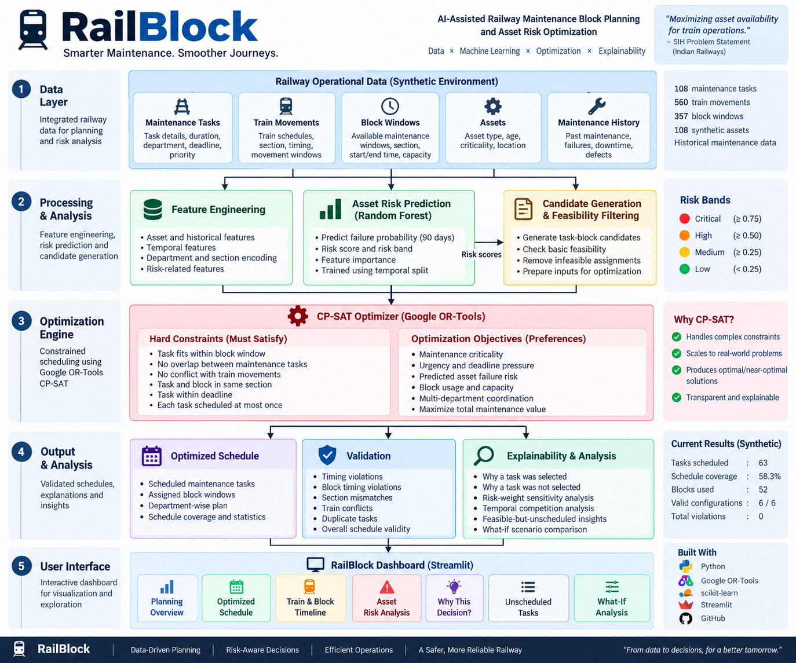

# RailBlock

### AI-Assisted Railway Maintenance Block Planning & Asset Risk Optimization

RailBlock is a decision-support prototype for coordinating railway infrastructure maintenance with train operations.

The system combines **Operations Research, Machine Learning, schedule validation, and explainable decision analysis** to determine which maintenance tasks can be feasibly scheduled under its explicit model constraints while considering train movements, task deadlines, maintenance duration, departmental coordination, and predicted asset failure risk.

**Current stage — Phase 2.4.7:** RailBlock includes risk-aware CP-SAT scheduling, schedule validation, and sensitivity analysis. Its partial Phase 2.5 Streamlit dashboard visualizes and explains generated outputs; it does not yet support interactive re-optimization or What-if simulation.

> **SIH Problem Statement:** AI-Powered Automatic Block Planning to Maximize Asset Availability for Train Operations on Indian Railways.

---

## 🚦 The Problem

Railway infrastructure maintenance is performed by multiple technical departments such as:

- Engineering
- Signal & Telecommunication (S&T)
- Traction Distribution

Maintenance tasks compete for limited block windows while trains continue to operate through the same infrastructure.

A planning system therefore needs to answer:

> **Which maintenance tasks should be performed, where, and when, without creating operational conflicts?**

Manual or independently planned maintenance can result in:

- fragmented block usage
- unused block capacity
- conflicting maintenance activities
- train-operation conflicts
- delayed high-priority maintenance
- poor coordination between departments
- difficulty explaining why a task was selected or rejected

RailBlock approaches the problem as a **constrained optimization problem**, with machine learning used as an additional risk signal rather than as a replacement for operational constraints.

---

## 🏗️ System Architecture



RailBlock follows a hybrid Machine Learning + Operations Research architecture. 
Machine learning provides asset failure-risk signals, while constraint optimization 
determines operationally feasible maintenance schedules. The resulting schedules 
are independently validated and translated into explainable decisions.

## 🧠 Core Approach

RailBlock follows a hybrid:

**Machine Learning + Operations Research**

architecture.

```text
                    ┌─────────────────────┐
                    │ Synthetic Railway    │
                    │ Operational Data     │
                    └──────────┬──────────┘
                               │
             ┌─────────────────┼─────────────────┐
             │                 │                 │
             ▼                 ▼                 ▼
      Maintenance Tasks   Train Movements   Block Windows
             │                 │                 │
             └─────────────────┼─────────────────┘
                               │
                               ▼
                    ┌─────────────────────┐
                    │ Candidate Generation │
                    │ & Feasibility        │
                    └──────────┬──────────┘
                               │
             ┌─────────────────┴─────────────────┐
             │                                   │
             ▼                                   ▼
   ┌─────────────────────┐            ┌─────────────────────┐
   │ Asset Risk Model     │            │ Priority / Deadline │
   │ Random Forest        │            │ Pressure Analysis   │
   └──────────┬──────────┘            └──────────┬──────────┘
              │                                  │
              └────────────────┬─────────────────┘
                               ▼
                    ┌─────────────────────┐
                    │ CP-SAT Optimizer     │
                    │ Google OR-Tools      │
                    └──────────┬──────────┘
                               │
                               ▼
                    ┌─────────────────────┐
                    │ Optimized Maintenance│
                    │ Block Schedule        │
                    └──────────┬──────────┘
                               │
              ┌────────────────┼────────────────┐
              ▼                ▼                ▼
       Validation        Explainability    Risk Analysis
              │                │                │
              └────────────────┴────────────────┘
                               │
                               ▼
                         Dashboard
```

---

## ⚙️ Optimization Engine

The scheduling engine uses Google OR-Tools CP-SAT.

Instead of asking a neural network to directly generate a timetable, RailBlock first establishes which assignments are operationally feasible.

**Hard constraints include:**

- maintenance must fit inside a block window
- task cannot exceed its deadline
- maintenance tasks cannot overlap
- maintenance cannot conflict with train movements
- task and block must belong to the same section
- each task can be scheduled at most once
- block timing must remain valid

**Optimization preferences include:**

- maintenance criticality
- maintenance urgency
- deadline pressure
- block usage
- unused block capacity
- multi-department coordination
- predicted asset failure risk

This separation is intentional:

> Machine learning influences prioritization. Hard operational constraints determine feasibility.

---

## 🤖 Asset Risk Prediction

RailBlock includes a predictive maintenance-risk pipeline.

A Random Forest classifier estimates the probability that an asset will experience a failure within the next 90 days.

**Feature groups include:**

- asset age
- department
- asset type
- criticality
- time since last maintenance
- maintenance frequency
- defect frequency
- failure history
- historical downtime
- historical severity
- failure rate
- defect rate

The prediction target is:

```
failure_in_next_90d
```

Risk scores are converted into operational bands:

| Probability | Risk Band |
|---|---|
| ≥ 0.75 | Critical |
| ≥ 0.50 | High |
| ≥ 0.25 | Medium |
| < 0.25 | Low |

The model is trained and evaluated using a temporal split rather than randomly mixing historical observations.

---

## 📊 Risk Model Experiment

The current synthetic experiment produced the following Random Forest test results:

| Metric | Result |
|---|---|
| Precision | 0.6000 |
| Recall | 0.7500 |
| F1 | 0.6667 |
| ROC-AUC | 0.9904 |
| PR-AUC | 0.8750 |

- Test set: 108 observations
- 4 failure-positive observations

These results are experimental results on synthetic data and should not be interpreted as real-world railway predictive performance.

---

## 🔬 Risk-Aware Optimization

The predicted failure probability can be incorporated into the scheduling priority.

Conceptually:

```
Maintenance Priority
        =
Criticality
+       Urgency
+       Deadline Pressure
+       Risk Signal
```

The risk signal is deliberately treated as a soft optimization preference.

It cannot override:

- train conflicts
- block availability
- task duration
- section constraints
- deadlines
- maintenance conflicts

This creates a useful separation between:

**Feasibility**
> Can this maintenance task physically and operationally fit?

**Prioritization**
> If several feasible tasks compete for planning capacity, which should receive preference?

---

## 🔍 Explainability

RailBlock includes deterministic schedule explanations.

Instead of exposing solver variables or mathematical coefficients to users, the system translates scheduling decisions into operational language.

**Example — Why was this task selected?**

- The task fits within the available block window.
- Its maintenance duration fits the available capacity.
- The task satisfies its timing requirements.
- No scheduled train movement overlaps the maintenance interval.
- The task has relevant priority / urgency.
- The block provides suitable conditions for the required department.

The goal is:

> Complex reasoning inside. Simple explanation outside.

---

## 🧪 Schedule Validation

Every generated schedule is checked independently after optimization.

**Validation checks include:**

- timing violations
- block timing violations
- duration violations
- section mismatches
- duplicate tasks
- maintenance conflicts
- train conflicts

The validation framework is intentionally separate from the optimizer so that the generated schedule is independently checked.

---

## 📈 Current Optimization Results

Using the current synthetic railway environment:

- Maintenance tasks: 108
- Train movements: 560
- Block windows: 357
- Candidate assignments: 402

The current risk-aware optimizer produced:

- Tasks scheduled: 63
- Schedule coverage: 58.3%
- Blocks used: 52

All generated schedules tested during the risk-weight sensitivity experiment passed validation.

---

## 🧪 Risk-Weight Sensitivity

RailBlock was evaluated across six risk-weight configurations: 0, 25, 50, 100, 150, 200

| Risk Weight | Tasks Scheduled | Coverage | Blocks | Avg Scheduled Risk |
|---|---|---|---|---|
| 0 | 63 | 58.33% | 52 | 0.1760 |
| 25 | 63 | 58.33% | 52 | 0.1760 |
| 50 | 63 | 58.33% | 52 | 0.1760 |
| 100 | 63 | 58.33% | 52 | 0.1760 |
| 150 | 64 | 59.26% | 54 | 0.1739 |
| 200 | 64 | 59.26% | 54 | 0.1739 |

**Interpretation**

The schedule remained unchanged from risk weight 0 through 100.

At a risk weight of 150:

- one additional task was scheduled
- coverage increased from 58.33% to 59.26%
- two additional block windows were used
- average scheduled risk decreased from approximately 0.1760 to 0.1739

Increasing the weight from 150 to 200 produced no additional schedule change.

This indicates that the risk signal has a limited influence at lower weights and begins affecting feasible scheduling decisions at higher weights.

---

## ✅ Validation of Sensitivity Experiments

All six risk-weight configurations were independently validated.

| Risk Weight | Status | Violations |
|---|---|---|
| 0 | VALID | 0 |
| 25 | VALID | 0 |
| 50 | VALID | 0 |
| 100 | VALID | 0 |
| 150 | VALID | 0 |
| 200 | VALID | 0 |

- Valid configurations: 6 / 6
- Invalid configurations: 0 / 6
- Total violations: 0

This confirms that changing the ML risk weight did not introduce violations in the tested synthetic scenarios.

---

## 🧩 Feasibility vs Optimization

One important finding from the experiments is that a high predicted risk does not automatically mean that a task can be scheduled.

For example, the highest-risk synthetic asset had:

- Predicted risk: 0.8415
- Risk band: Critical

However, it had:

- Candidate blocks: 0

Therefore, increasing the risk weight cannot make it schedulable.

This demonstrates an important architectural principle:

> Feasibility comes before optimization.

The optimizer can choose between feasible alternatives, but it cannot violate operational constraints simply because an asset has a high predicted risk.

---

## 🕒 Temporal Competition Analysis

RailBlock also performs counterfactual schedule analysis.

For feasible-but-unselected maintenance tasks, the system compares:

```
Actual schedule
       ↓
Train-only schedule
       ↓
Empty-block scenario
```

This helps determine whether an unselected task was blocked by:

- another maintenance task
- train occupancy
- insufficient block capacity
- timing limitations
- lack of feasible windows

This provides evidence for why a feasible task was not selected, rather than simply labeling it "rejected."

---

## 🔬 Experimental Findings

The current experiments produced several useful observations.

**1. Feasibility is a major limiting factor**

Some maintenance tasks cannot be scheduled because no compatible block window exists.

A high risk score does not override this constraint.

**2. Risk can influence feasible scheduling decisions**

The sensitivity experiment showed that increasing the risk weight eventually changed the selected schedule.

**3. Risk influence is not monotonic in every metric**

At higher risk weights, average scheduled risk decreased slightly, while average unscheduled risk increased.

This is expected when the optimizer moves some higher-risk feasible work into the schedule.

**4. Multi-department coordination can be explicitly modelled**

RailBlock rewards compatible maintenance work from multiple departments when they can share a suitable block.

**5. Counterfactual analysis can explain rejected feasible work**

Temporal competition analysis distinguishes between tasks blocked by trains and tasks blocked by other scheduled maintenance.

---

## 🏗️ System Architecture

```text
                    ┌──────────────────────┐
                    │     Data Layer        │
                    │                        │
                    │ Maintenance            │
                    │ Trains                 │
                    │ Blocks                 │
                    │ Assets                 │
                    │ Maintenance History    │
                    └──────────┬───────────┘
                               │
                               ▼
                    ┌──────────────────────┐
                    │ Feature Engineering   │
                    │                        │
                    │ Asset Features         │
                    │ Risk Features          │
                    │ Temporal Windows       │
                    └──────────┬───────────┘
                               │
                ┌──────────────┴──────────────┐
                │                             │
                ▼                             ▼
       ┌─────────────────┐          ┌──────────────────┐
       │ Machine Learning │          │ Scheduling Logic │
       │                  │          │                  │
       │ Random Forest    │          │ Candidate        │
       │ Failure Risk     │          │ Generation       │
       └────────┬────────┘          └────────┬─────────┘
                │                           │
                │                           ▼
                │                  ┌──────────────────┐
                └─────────────────►│ CP-SAT Optimizer │
                                   │                  │
                                   │ Constraints      │
                                   │ Objectives       │
                                   └────────┬─────────┘
                                            │
                                            ▼
                                   ┌──────────────────┐
                                   │ Schedule Output  │
                                   └────────┬─────────┘
                                            │
                         ┌──────────────────┼──────────────────┐
                         ▼                  ▼                  ▼
                  ┌────────────┐    ┌──────────────┐   ┌────────────┐
                  │ Validator  │    │ Explainability│   │ Analytics │
                  └────────────┘    └──────────────┘   └────────────┘
                                            │
                                            ▼
                                   ┌──────────────────┐
                                   │    Dashboard     │
                                   └──────────────────┘
```

---

## 📁 Project Structure

```text
RailBlock/
│
├── data/
│   ├── raw/
│   ├── processed/
│   └── synthetic/
│
├── docs/
│   ├── problem_definition.md
│   ├── data_dictionary.md
│   └── architecture.md
│
├── notebooks/
│
├── src/
│   ├── data/
│   │   ├── generate_synthetic_data.py
│   │   ├── generate_maintenance_history.py
│   │   ├── build_asset_features.py
│   │   ├── validate_data.py
│   │   └── validation.py
│   │
│   ├── optimization/
│   │   ├── model.py
│   │   ├── model_risk_aware.py
│   │   ├── candidates.py
│   │   ├── compare_schedules.py
│   │   ├── solver.py
│   │   ├── solver_risk_aware.py
│   │   ├── diagnostics.py
│   │   ├── explain.py
│   │   ├── validator.py
│   │   ├── risk_candidate_analysis.py
│   │   ├── risk_decision_analysis.py
│   │   ├── feasible_competition_analysis.py
│   │   ├── true_competition_analysis.py
│   │   └── risk_weight_sensitivity.py
│   │
│   └── prediction/
│       ├── build_risk_dataset.py
│       ├── risk_baseline.py
│       ├── train_risk_model.py
│       ├── train_risk_random_forest.py
│       └── generate_risk_scores.py
│
├── dashboard/
│   ├── app.py
│   ├── components/
│   └── utils/
│
├── tests/
│
├── outputs/
│
├── requirements.txt
├── pytest.ini
├── .gitignore
└── README.md
```

---

## 🧰 Technology Stack

| Layer | Technology |
|---|---|
| Programming Language | Python |
| Data Processing | Pandas |
| Optimization | Google OR-Tools CP-SAT |
| Machine Learning | scikit-learn |
| Risk Model | Random Forest |
| Model Serialization | joblib |
| Dashboard | Streamlit |
| Testing | pytest |
| Data Format | CSV |
| Version Control | Git / GitHub |

---

## 🚀 Getting Started

### 1. Clone the repository

```bash
git clone https://github.com/chethanrajcareer-afk/RailBlock.git
cd RailBlock
```

### 2. Create a virtual environment

**Windows PowerShell**

```powershell
python -m venv .venv
.venv\Scripts\Activate.ps1
```

### 3. Install dependencies

```bash
pip install -r requirements.txt
```

### 4. Generate / validate synthetic data

```bash
python -m src.data.generate_synthetic_data
python -m src.data.validate_data
```

### 5. Run tests

```bash
pytest -q
```

### 6. Run the dashboard

```bash
streamlit run dashboard/app.py
```

### 7. Generate a risk-aware scheduling experiment report

```bash
python -m src.optimization.solver_risk_aware
```

This writes the risk-aware schedule to
`outputs/risk_aware_schedule.csv` and a reproducibility report to
`outputs/risk_aware_experiment_report.json`. The report records the input
file fingerprints, solver settings, search metrics, schedule coverage, and
independent validation result for that run.

---

## 🧪 Reproducibility

RailBlock currently uses synthetic deterministic data so that experiments can be reproduced without access to proprietary railway systems.

The current synthetic environment includes:

- 18 stations
- 17 sections
- 108 maintenance tasks
- 560 train movements
- 357 block windows
- 108 synthetic assets
- historical maintenance events
- multiple departments
- multiple infrastructure sections

The data is fictional and does not represent real Indian Railways operational data.

---

## ⚠️ Limitations

RailBlock is a research and engineering prototype.

It currently does not:

- connect to live Indian Railways systems
- consume live train traffic
- use proprietary railway maintenance records
- control railway infrastructure
- guarantee real-world operational feasibility
- replace railway safety procedures
- replace human operational authority

All current ML performance and optimization results are based on synthetic experimental data.

The current Random Forest results should therefore be interpreted as a demonstration of the modelling pipeline rather than evidence of production predictive accuracy.

---

## 🔐 Safety & Operational Principle

RailBlock is designed as a decision-support system, not an autonomous railway control system.

The optimization engine operates within explicitly defined constraints.

In a real deployment, railway safety rules, signalling requirements, possession/blocking procedures, operational approvals, engineering rules, and human authority would remain higher-level constraints and decision requirements.

The prototype does not attempt to automate those responsibilities.

---

## 🛣️ Roadmap

### Completed

- [x] Synthetic railway environment
- [x] Data validation
- [x] CP-SAT maintenance scheduling
- [x] Deadline pressure
- [x] Multi-department coordination
- [x] Schedule validation
- [x] Schedule explainability
- [x] Asset risk dataset
- [x] Random Forest risk prediction
- [x] Risk-aware optimization
- [x] Feasibility analysis
- [x] Risk decision analysis
- [x] Temporal competition analysis
- [x] Risk-weight sensitivity analysis
- [x] Asset-risk visualization dashboard
- [x] Schedule timeline / Gantt-style view
- [x] "Why this block?" decision-explanation view
- [x] GitHub repository

### Next

- [ ] Interactive re-optimization dashboard
- [ ] Baseline vs risk-aware comparison
- [ ] What-if scenario simulation
- [ ] API layer
- [ ] Improved experiment reporting

### Longer Term

- [ ] Dynamic re-optimization
- [ ] Delay propagation modelling
- [ ] Railway network graph representation
- [ ] Reliability-aware planning
- [ ] Evaluation with realistic / authorized railway datasets

---

## 📚 Project Philosophy

RailBlock deliberately avoids treating "AI" as a black box.

The architecture follows:

```
Prediction
    ↓
Risk Signal
    ↓
Feasibility
    ↓
Optimization
    ↓
Validation
    ↓
Explanation
```

Machine learning estimates future asset risk.

Operations Research handles constrained scheduling decisions.

Validation independently checks the generated schedule.

Explainability communicates why scheduling decisions were made.

Together, these components create a transparent decision-support workflow instead of attempting to make a single AI model generate the entire maintenance schedule.

---

## 💡 Why Operations Research Instead of "Just AI"?

Railway maintenance scheduling is fundamentally a constrained decision problem.

A model may predict that an asset is likely to fail, but prediction alone does not answer:

> When can maintenance actually happen?

The answer depends on:

- available block windows
- train movements
- maintenance duration
- section
- deadlines
- simultaneous maintenance
- operational constraints
- departmental coordination

This is why RailBlock combines:

```
Machine Learning
       +
Operations Research
       +
Validation
       +
Explainability
```

rather than treating a predictive model as the complete solution.

---

## 📊 Current Project Snapshot

**RailBlock**

| Metric | Value |
|---|---|
| Maintenance tasks | 108 |
| Train movements | 560 |
| Block windows | 357 |
| Synthetic assets | 108 |
| Candidate assignments | 402 |

**Risk model**

| Metric | Value |
|---|---|
| Model | Random Forest |
| Prediction horizon | 90 days |
| ROC-AUC | 0.9904 |
| PR-AUC | 0.8750 |
| F1 | 0.6667 |

**Risk-aware optimizer**

| Metric | Value |
|---|---|
| Tasks scheduled | 63 |
| Schedule coverage | 58.3% |
| Blocks used | 52 |

**Sensitivity experiment**

| Metric | Value |
|---|---|
| Configurations | 6 |
| Optimal solutions | 6 |
| Valid schedules | 6 |
| Total violations | 0 |

All figures above are from the current synthetic experimental environment.

---

## 👨‍💻 Project Status

**Research / Engineering Prototype**

The core RailBlock pipeline currently includes:

```
Synthetic Data
      ↓
Feature Engineering
      ↓
Asset Risk Prediction
      ↓
Candidate Generation
      ↓
CP-SAT Optimization
      ↓
Schedule Validation
      ↓
Risk & Competition Analysis
      ↓
Explainable Decisions
      ↓
Dashboard
```

---

## 📌 Disclaimer

RailBlock is an academic and engineering prototype developed for experimentation around railway maintenance scheduling.

It is not affiliated with, endorsed by, or operated by Indian Railways, and it does not use proprietary Indian Railways operational data.

All railway datasets currently used by the project are synthetic.

---

## ⭐ Repository

GitHub: [https://github.com/chethanrajcareer-afk/RailBlock](https://github.com/chethanrajcareer-afk/RailBlock)
